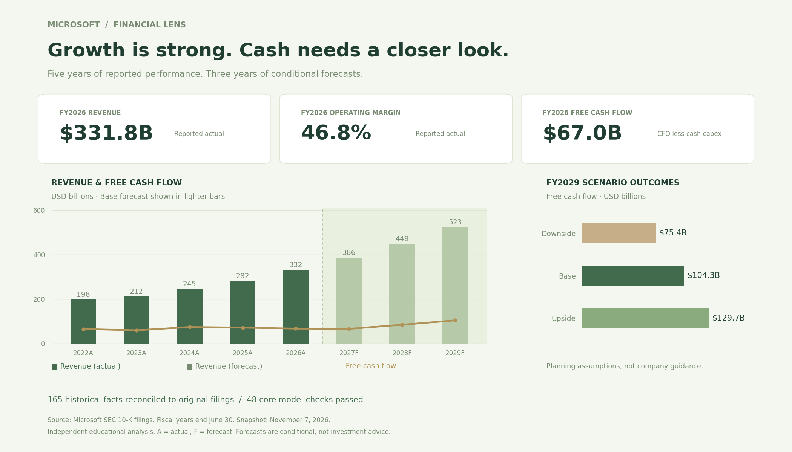

# Microsoft Financial Forecasting & Performance Analysis

**An SEC-sourced financial case study connecting operating performance, capital investment, and free cash flow through an integrated three-statement model.**

Built for a management question: **Can Microsoft's growth fund its capital needs, and which operating drivers deserve the most attention?**

`FP&A` · `Corporate finance` · `Financial modeling` · `Python` · `SQL` · `Excel` · `Data visualization`

[Executive memo](docs/executive_memo.pdf) · [Excel financial model](models/financial_model.xlsx) · [Financial report](dashboards/financial_report.pdf) · [7-slide walkthrough](docs/executive_walkthrough.pdf)



*Model-generated overview. A = reported actual; F = analyst forecast. Fiscal years end June 30. Snapshot: November 7, 2026.*

## Start here — a two-minute review

1. **Read the decision:** [two-page executive memo](docs/executive_memo.pdf) explains the recommendation, triggers, and trade-offs.
2. **Inspect the model:** [Excel workbook](models/financial_model.xlsx) includes reported history, editable assumptions, linked statements, scenarios, sensitivities, and audit checks.
3. **Challenge the results:** [backtest summary](results/backtest_summary.csv) and [individual forecast errors](results/forecast_errors.csv) show where the model underperformed.
4. **Trace the evidence:** [source manifest](docs/source_manifest.csv) and [filing reconciliation](results/filing_reconciliation.csv) connect the analysis to original SEC filings.

## What the project demonstrates

| Finance capability | Evidence in this repository |
| --- | --- |
| Historical performance analysis | Five annual periods of revenue, profitability, capital intensity, working capital, and cash generation |
| Integrated financial modeling | Three projected statements linked through earnings, working capital, PP&E, finance leases, financing, and equity |
| Scenario planning | Base, upside, and downside cases with documented assumptions and explicit liquidity consequences |
| Quantitative validation | Four one-year historical holdouts, a prior-year-growth baseline, error metrics, and signed bias |
| Data controls | Original filing dates, fiscal-period checks, normalized units, keyed SQLite facts, and source reconciliation |
| Management communication | A recommendation memo, four report views, an interactive dashboard, and an executive walkthrough |

## Financial findings

Revenue growth alone does not explain cash generation. In FY2026, revenue increased **17.8%**, while cash capex reached **34.9% of revenue** and free cash flow decreased **6.5%**.

| Metric | FY2026 actual | FY2029 base forecast |
| --- | ---: | ---: |
| Revenue | $331.8B | $522.8B |
| Operating income / EBIT | $155.2B | $238.8B |
| Operating margin | 46.8% | 45.7% |
| Cash capex | $115.9B | $182.7B |
| Free cash flow | $67.0B | $104.3B |

**Defined FY2029 scenario range:** FCF of **$75.4B–$129.7B**. These are conditional analyst estimates, not company guidance or investment return forecasts.

### Management implications

- **Gate incremental capital commitments.** Review cash capex alongside new finance leases. A one-percentage-point increase in capex intensity reduces modeled FY2027 FCF by **$3.9B**.
- **Protect margin and collection discipline.** A one-percentage-point increase in operating margin adds **$3.2B** to FY2027 FCF; one additional collection day consumes **$1.1B**, holding other drivers fixed.
- **Keep discretionary distributions flexible.** The defined downside requires **$7.4B** of cumulative new modeled borrowing to preserve the cash floor while dividend and buyback ratios stay fixed.

These local sensitivities use different shock sizes. They support planning discussions; they are not causal estimates. See the memo for monitoring triggers, limitations, and trade-offs.

## Forecast validation — including the misses

One-year targets are FY2023–2026. Each origin uses original annual facts available by that fiscal year's filing date. The baseline extrapolates each target metric's latest annual growth.

| Target | Holdouts | Model MAE | MAPE | MAE versus baseline |
| --- | ---: | ---: | ---: | --- |
| Revenue | 4 | $11.1B | 4.6% | 12.0% lower |
| Operating income / EBIT | 4 | $9.8B | 8.0% | **4.8% higher** |
| Free cash flow | 4 | $12.0B | 18.4% | 18.6% lower |

**What did not work:** EBIT forecasts lagged the simple baseline, and **all four FCF forecasts exceeded actual FCF**. Four retrospective observations per metric do not establish statistical forecasting skill. Researcher hindsight remains a limitation even with filing-date controls.

**Implementation evidence:** 165 selected historical facts reconcile to original 10-K inline XBRL; 48 core model checks pass; six Python test groups cover accounting, stress cases, source availability, and independently evaluated Excel formulas. A further 396 JavaScript/Python value comparisons check dashboard calculations. These checks validate implementation, not future economic outcomes.

## Model design

- **Scope:** Microsoft Corporation (`MSFT`, CIK `0000789019`); FY2022–2026 actuals and FY2027–2029 forecasts. FY2019–2021 supply backtest warmup.
- **Operating assumptions:** growth anchored to the latest two annual growth rates; gross margin, operating margin, tax, and stock compensation anchored to three-year means; other activity ratios anchored to the latest year.
- **Statement linkage:** earnings feed cash flow and equity; operating balances determine working-capital cash changes; cash capex and noncash finance leases roll into PP&E.
- **Funding rule:** cash follows the cash-flow statement. New modeled borrowing covers a stated minimum-cash shortfall. Interest uses opening debt and finance leases, avoiding circularity.
- **Sensitivity families:** revenue growth × operating margin; collection days × cash capex intensity. Excel also reports EBIT and net income for the growth/margin grid.
- **Definitions:** FCF = CFO minus cash payments for PP&E. Finance lease additions and principal payments are shown separately. Data are normalized to USD millions; reports and dashboard display billions.

The [18-driver assumptions register](docs/assumptions_register.csv), [data dictionary](docs/data_dictionary.csv), and [methodology](docs/methodology.md) document units, sources, rationale, scenario ranges, and model boundaries.

## Explore the interactive dashboard

Six views cover financial overview, operating drivers, scenarios and sensitivities, accuracy and risks, financial statements, and source evidence. Scenario selection and four adjustable operating drivers recalculate the projected statements in the browser; current forecasts can be exported to CSV.

From the repository root:

```bash
python -m http.server 8000
```

Open **http://localhost:8000/dashboards/web/**. No API key is needed to review the bundled analysis. The public [financial report](dashboards/financial_report.pdf) and image above provide a review path without running the app. The separately hosted Sites demo is owner-private.

## Reproduce the analysis

Requirements: **Python 3.12+**; **Node.js 22+** for dashboard parity checks; Excel or a compatible workbook reader for the model.

```bash
git clone https://github.com/ricoxvl/microsoft-financial-analysis.git
cd microsoft-financial-analysis

python -m venv .venv
# macOS/Linux:
source .venv/bin/activate
# Windows PowerShell: .venv\Scripts\Activate.ps1

python -m pip install -r requirements.txt
python src/reconcile.py
python src/build.py
python -m unittest discover -s tests -v
node tests/test_dashboard.mjs
python src/reports.py
```

The preserved source files allow these commands to run without downloading financial data. The GitHub Actions workflow runs reconciliation, model checks, tests, JavaScript parity, and report generation on pushes and pull requests. Its current run status is visible in the [Actions tab](https://github.com/ricoxvl/microsoft-financial-analysis/actions).

For SEC refresh instructions, dashboard-data updates, optional DOM tests, and detailed modeling notes, see [reproduction documentation](docs/reproduction.md). Refreshing SEC data requires your own descriptive research identity/contact in `SEC_USER_AGENT` and adherence to SEC fair-access rules.

## Repository map

```text
├── src/                   # SEC ingestion, forecast, backtest, Excel/PDF generators
├── models/                # Editable financial_model.xlsx
├── data/
│   ├── raw/               # Preserved SEC API response and original annual filings
│   ├── processed/         # Normalized history, source facts, dashboard model
│   └── financials.db      # SQLite facts and annual KPI view
├── dashboards/            # Four-page PDF report and interactive web dashboard
├── docs/                  # Memo, sources, assumptions, methods, walkthrough
├── results/               # Forecast errors, scenarios, sensitivities, check evidence
├── tests/                 # Accounting, provenance, Excel, and JS validation
└── .github/workflows/     # Reproducibility and model-validation workflow
```

## Boundaries and next steps

This is an **independent educational public-data analysis**, not company-sponsored work, production FP&A, or investment advice. It makes no claim of realized savings or improved company earnings.

The model is annual and aggregate. It excludes FY2027 interim inputs, segment forecasts, acquisitions, securities sales, new operating leases, detailed deferred taxes, and a debt maturity schedule. Other assets and liabilities are held fixed; depreciation and interest use simplified proxies. Automated model and DOM checks passed; visual browser testing was unavailable during the initial build.

Possible extensions are a segment-level revenue model, asset-cohort and debt schedules, more historical validation periods, and a native Power BI report. A Power BI `.pbix` is **not** included; [import guidance](docs/power_bi_import.md) is provided.

**Source basis:** original Microsoft SEC annual filings and the [SEC companyfacts API](https://data.sec.gov/api/xbrl/companyfacts/CIK0000789019.json). The [project charter](docs/project_overview.md) explains the company choice and decision scope.
